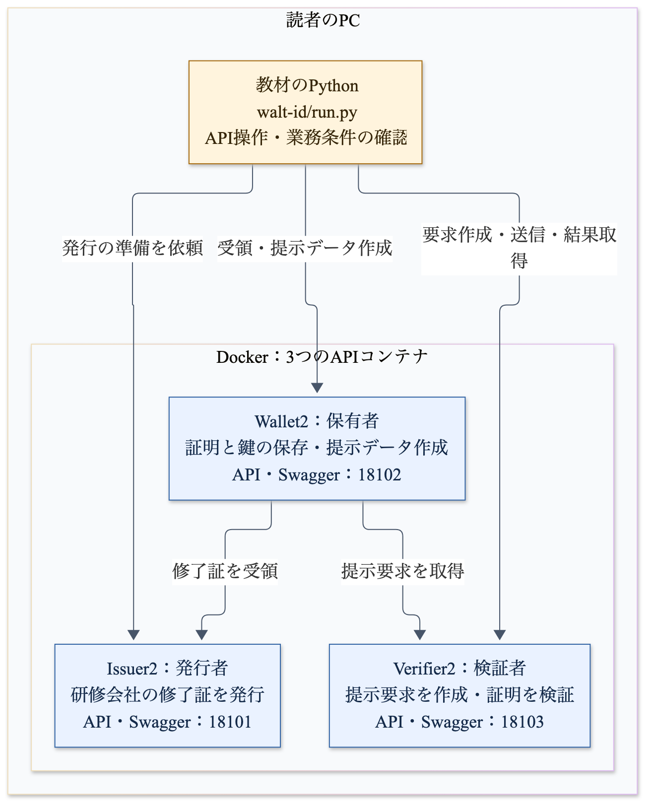
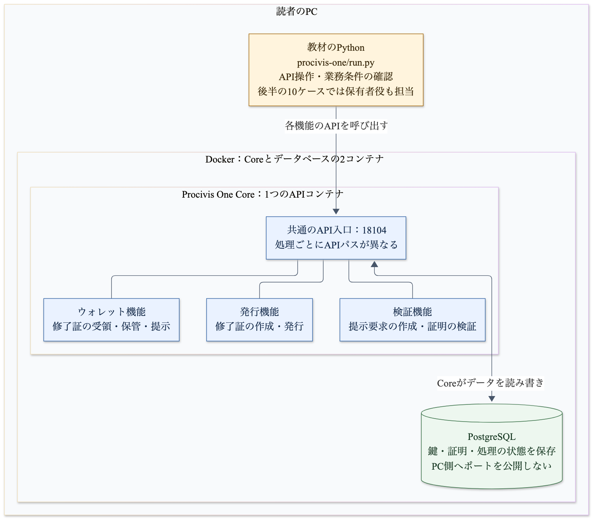

# ローカル教材のシステム構成

同じ研修修了証を、walt.idとProcivis One Coreでそれぞれ発行・提示・検証します。
以下は、このリポジトリの[compose.yaml](../compose.yaml)と実行スクリプトに対応した構成図です。
両OSSを別々に動かす実験であり、walt.idで発行した証明をProcivisへ渡す相互運用試験は後続の題材です。

黄色は今回作った教材のPythonスクリプト、青色はOSSが提供する機能です。
PythonスクリプトはPC上で実行し、OSSはDockerコンテナで起動します。
APIの公開先は、このPCからアクセスできる127.0.0.1に限定しています。
図中のポート番号はPCからアクセスするときの番号です。

## walt.id：役割ごとに3つのAPIサービス



[図の編集用データ（Mermaid）](images/walt-architecture.mmd)

| コンテナ | APIとSwagger | 教材で担当する処理 |
|---|---|---|
| issuer | http://localhost:18101/ | 研修会社として修了証を発行する |
| wallet | http://localhost:18102/ | 受講者の修了証と鍵を保存し、提示するデータを作る |
| verifier | http://localhost:18103/ | 採用企業が必要とする項目を要求し、提示された証明を検証する |

[walt-id/run.py](../walt-id/run.py)が各APIを順に呼び出します。
Wallet2はIssuer2から修了証を受領し、Verifier2の提示要求に応じたデータを作成します。
今回の構成では、その提示データの送信はPythonが担当します。
失敗例で、送信直前に値や署名を変更できるようにするためです。

Verifier2の検証後、Pythonが発行者の信頼、必須項目、対象研修、申込者名を追加で確認します。
この業務判定は教材側に実装しており、OSSの検証結果と分けて表示します。
Swaggerは各APIを操作する開発者向け画面です。受講者向けのウォレット画面は後続で作成します。

3つのコンテナは、今回のCompose設定ではissuerのネットワーク名前空間を共有しています。
そのため、コンテナ内の通信でもlocalhostと18101〜18103番ポートを使えます。
Mac側への3ポートの公開設定もissuerにまとめていますが、処理を担当するプロセスとコンテナは3つです。
Wallet2の保存先はメモリであり、この構成では外部データベースを起動しません。

## Procivis：1つのCoreが3つの機能を提供



[図の編集用データ（Mermaid）](images/procivis-architecture.mmd)

| コンテナ | PCからの接続先 | 教材で担当する処理 |
|---|---|---|
| core | http://localhost:18104/ の各APIパス | 発行・受領・提示・検証を提供する。ルートURL自体は画面を返さない |
| database | PC側へのポート公開なし | CoreのデータをPostgreSQLへ保存する |

Coreの青い3つの機能は、同じプロセスに含まれます。
API入口と各機能を結ぶ線は機能の構成を表しており、別サービス間のHTTP通信を意味しません。
CoreはDocker内のdatabaseへ接続してデータを読み書きします。
今回のPostgreSQLは一時ファイルシステムを使い、停止後にデータを保持する運用は対象にしていません。

[procivis-one/run.py](../procivis-one/run.py)には、次の2つの実行経路があります。

1. 最初の通常の一往復では、Coreの発行・ウォレット・検証の各機能を使います。Pythonが受領と提示を指示し、Coreのウォレット機能が処理します。
2. 続く10ケースでは、Python自身が保有者の鍵を持ち、Coreから証明を受領して提示します。発行と検証はCoreが担当し、保有者役のPythonが提示する値や署名を変えて失敗例を作ります。

Coreが受理した後の発行者の信頼や研修条件の確認は、walt.idと同様にPythonが担当します。
教材では、最初の一往復で保有者を別の組織として作りますが、発行者と検証者には同じ識別子を使っています。
この構成はプロトコルを試すためのもので、実際の研修会社と採用企業の権限分離を検証するものではありません。

CoreにはSwaggerを提供する実装がありますが、2026年10月22日のこの教材のDockerイメージでは、画面用ファイルの組み込みに問題があり、Swaggerは404になります。
API定義は http://localhost:18104/api-docs/openapi.json で取得できます。
Swaggerの表示修正と画面確認は残作業です。

## 起動前の準備と、記事で示す範囲

[scripts/prepare.py](../scripts/prepare.py)が鍵と設定ファイルを生成し、Procivisでは固定版のソースも取得します。
Docker Composeで起動後、[scripts/wait-ready.py](../scripts/wait-ready.py)が各APIへアクセスし、JSONを取得できる状態まで待ちます。
起動確認はAPIへの接続確認であり、修了証の発行や検証の成功は、その後の各run.pyで確かめます。

第3回の環境構築の説明では、この構成図と起動結果、SwaggerでのAPI操作を対応させます。
発行・提示・検証の説明では、修了証に含めた項目と実際に提示した項目を示し、APIから戻る検証結果と教材側の業務判定を分けて説明します。
利用者向けの発行画面、ウォレット画面、検証画面は、このAPI構成の上に追加する後続の成果物です。

## 図を更新する

PNGはMermaid CLI 12.0.0で生成しました。
リポジトリのルートで次を実行すると、編集用データから画像を再生成できます。
図の生成に使うNode.jsとブラウザ環境は、修了証の実験を実行するだけなら不要です。

```sh
npx --yes @mermaid-js/mermaid-cli@12.0.0 -i docs/images/walt-architecture.mmd -o docs/images/walt-architecture.png -s 2
npx --yes @mermaid-js/mermaid-cli@12.0.0 -i docs/images/procivis-architecture.mmd -o docs/images/procivis-architecture.png -s 2
```
